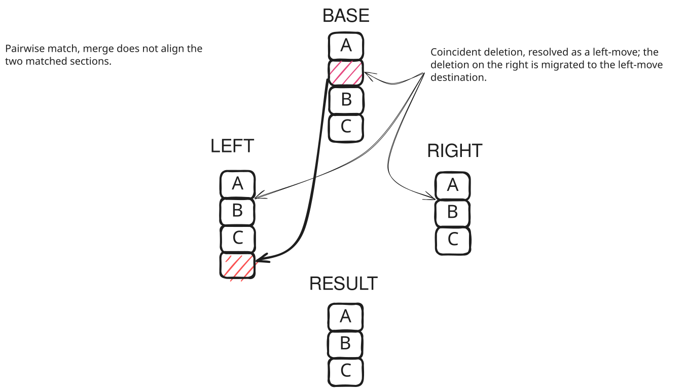
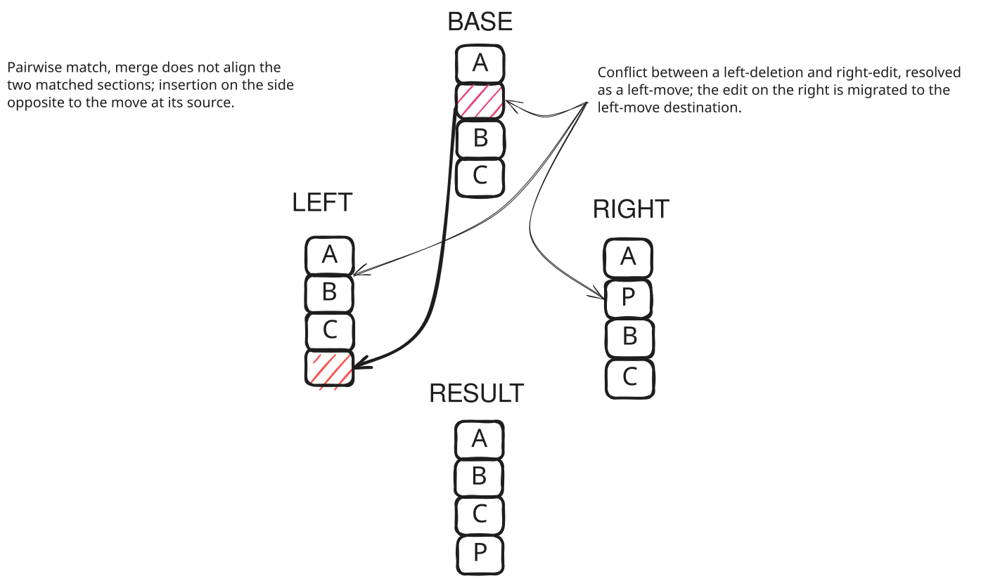
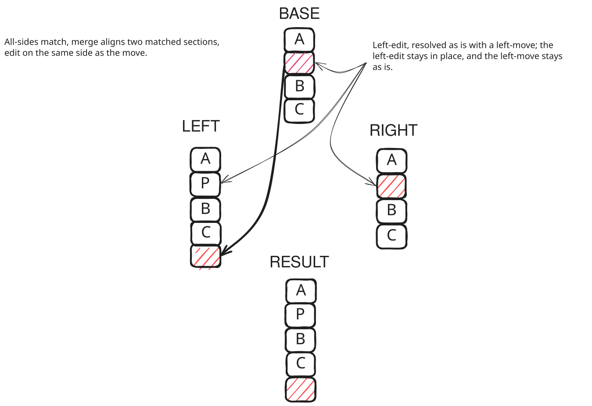
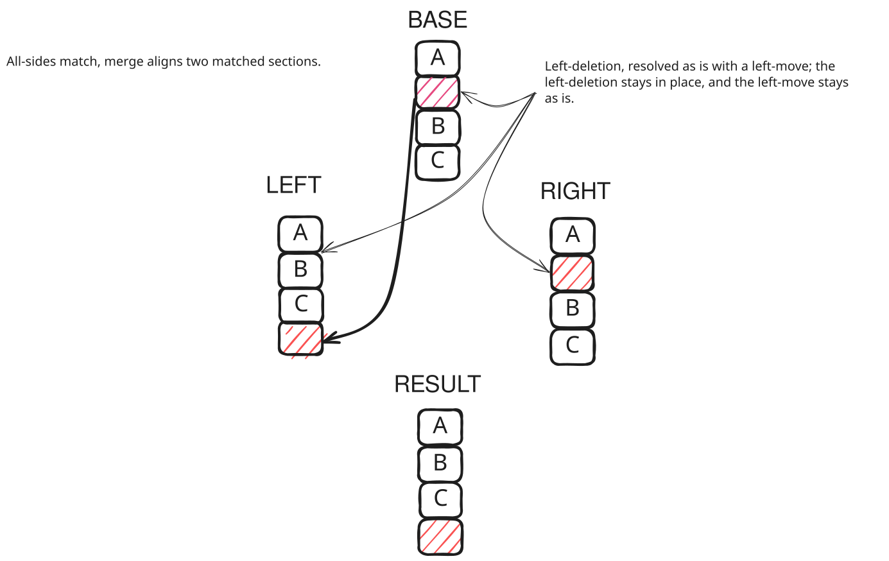
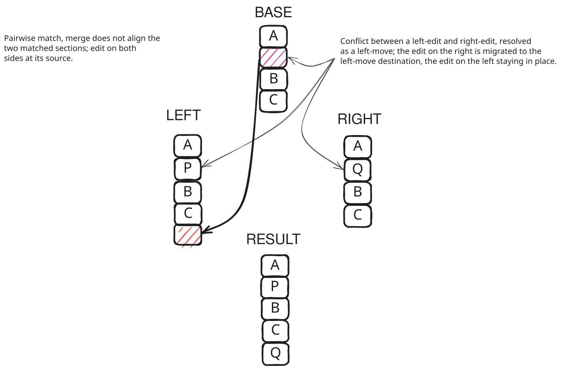
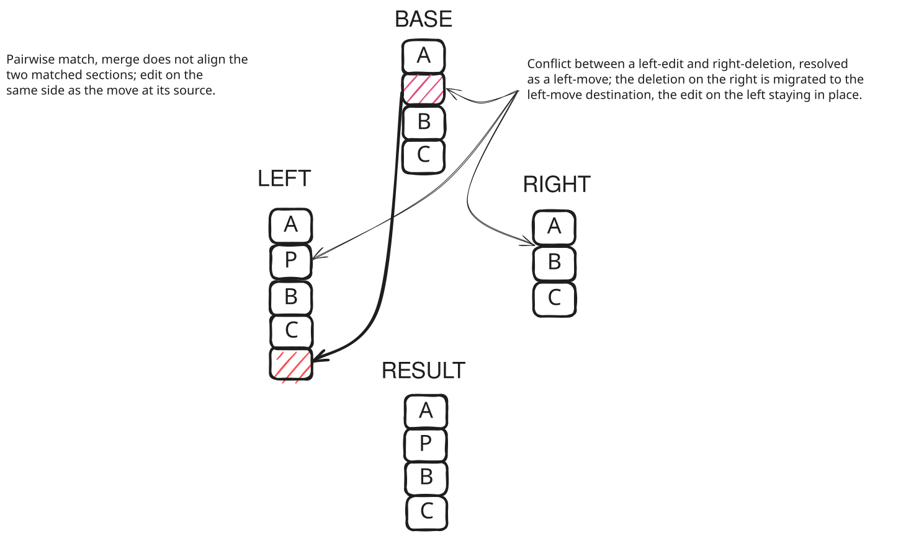
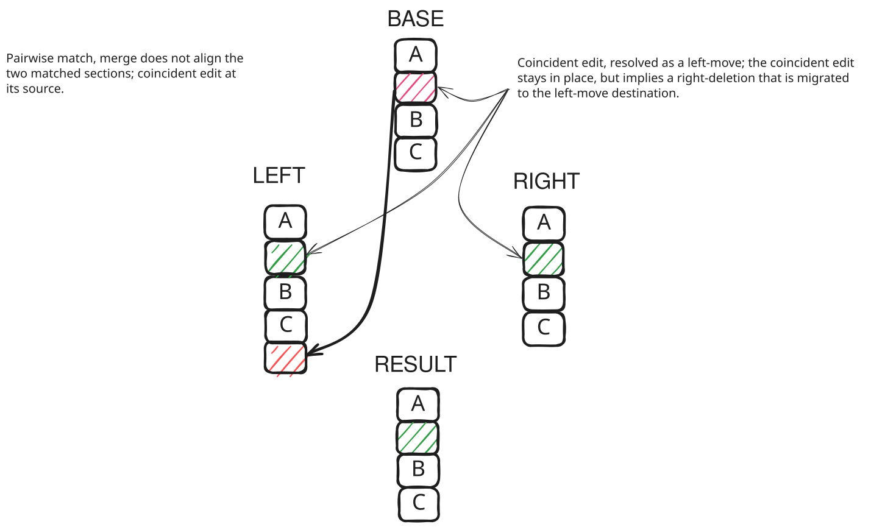
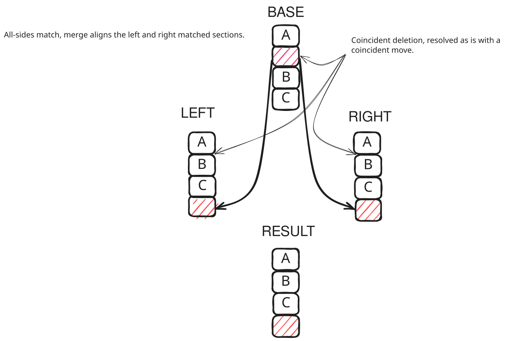
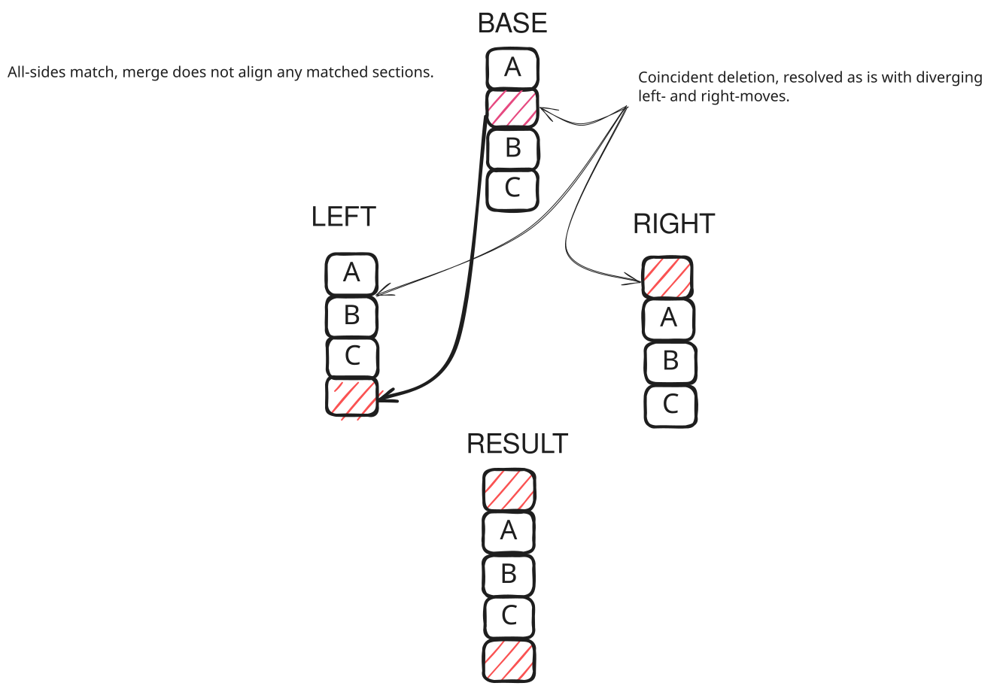

# Code Motion & Migration

## 1. What is Code Motion?

Code motion occurs when a piece of code present in the base commit moves to a new location in either the left branch,
the right branch, or both:
1. **Intra-file code motion**: The code moves to a different location within the same file (and does not form part of the
   longest common subsequence for that file's three-way merge).
2. **Inter-file code motion**: The code moves from one file to another file with a different path (including file splits,
   joins, and extractions).

In both cases, the move has:
- A **source**: The original location in the base version.
- A **destination**: The new location on the left or right side.

Kinetic Merge detects moves across all paths modified, added, or deleted in either branch. When a move is identified,
modifications made to the moved code on the opposite branch must follow the move to its destination. This process is
termed **migration**.

Migration divides into two distinct mechanisms:
- **Change Migration** (substitutions): Migrating edits or outright deletions of the moved content.
- **Splice Migration**: Migrating content inserted adjacent to the moved code (or local boundary edits).

---

## 2. Coincident and Divergent Moves

When code from a single base source moves on *both* the left and right sides:
- **Coincident Move**: The code moves to the same relative position on both sides (in the same file, aligned by the
  three-way merge). Kinetic Merge treats this as a shared refactoring; no conflicts are generated, and the content is
  preserved at its new location.
- **Divergent Move**: The code moves to different files or to non-aligned locations within the same file. Kinetic Merge
  honours both destinations equally, allowing the content to appear in both locations (unless one side deleted the
  containing file).

When code moves to both sides, changes (edits/deletions) on the base are not migrated: because the original code was
moved on both branches, neither side deleted it.

---

## 3. Change Migration (Substitutions)

Change migration applies when a section of code in the base moves to a destination on one side (say, the right), while
the opposite side (the left) either edits or deletes that content at its original location:

- **Source Anchor**: The base section `sourceAnchor`.
- **Move Destination Anchor**: The section on the move side `moveDestinationAnchor`.
- **Opposite Side Anchor**: The corresponding section on the opposite side `oppositeSideAnchor` (or a composite edit
  sequence).

### Mechanism
1. **Speculative Detection**: In the first merge pass, `FirstPassMergeResult` records speculative move destinations and
   speculative substitutions (edits or deletions) for each base section.
2. **Global Evaluation**: `MoveDestinationsReport.evaluateSpeculativeSourcesAndDestinations` inspects all speculative
   moves globally. If a base section was moved to one side and edited/deleted on the opposite side, it produces a
   `Substitution`:

   `moveDestinationAnchor -> replacementSections`

3. **Suppression at Origin**: During the second merge pass, `ConflictResolvingMergeAlgebra` suppresses the edit or
   deletion at its original source location so it does not remain marooned in the old file.
4. **Substitution Application**: `applySubstitutions` replaces `moveDestinationAnchor` at the destination with the
   migrated replacement sections.

### Change Migration Diagrams

#### Migrating a Deletion:


#### Migrating an Edit:


#### Simple Move with an Edit on the Move Side:


#### Simple Move with a Deletion on the Move Side:


#### Migrating an Edit with an Edit on the Move Side:


#### Migrating a Deletion with an Edit on the Move Side:


#### Migrating a Deletion with a Coincident Edit:


#### Coincident Move:


#### Divergent Moves:


---

## 4. Splice Migration

Splice migration addresses content **inserted adjacent to moved code** on the opposite side (or local edits touching
the boundaries between moved code and surrounding context).

### The Anchors of a Move
Each move is characterized by an `AnchoredMove`:
- `sourceAnchor`: The base section.
- `moveDestinationAnchor`: The section at the move destination.
- `oppositeSideAnchor`: The unmoved anchor on the opposite side (either `Plain` for an exact match, or an edit
  boundary).

### Grouping Anchored Moves by Parallel Matches Groups
Rather than evaluating splices independently for every moved section, Kinetic Merge groups anchored moves using their
`ParallelMatchesGroupId` (`anchoredMovesByParallelMatchesGroupId`):
- Successive anchored moves that belong to the same parallel matches group are ordered by their base start offsets:
  `M_1, M_2, ..., M_k`.
- **Intermediate Splices**: For adjacent moves `M_i` and `M_{i+1}` in the group, the intermediate sections sitting
  between them are extracted directly on the base, move destination, and opposite sides:
  ```scala
  val intermediateBase = intermediateSectionsBetween(baseFile, M_i.sourceAnchor, M_{i+1}.sourceAnchor)
  val intermediateDest = intermediateSectionsBetween(destFile, M_i.destinationAnchor, M_{i+1}.destinationAnchor)
  val intermediateOpp  = intermediateSectionsBetween(oppFile, M_i.oppositeAnchor, M_{i+1}.oppositeAnchor)
  ```
  A 3-way merge is executed on these intermediate sections (`spliceMerge`), and the resulting splice is associated with
  the succeeding anchor `M_{i+1}`.
- **Boundary Splices**: For the first move `M_1` and last move `M_k` of the group, outward directional scanning finds
  preceding and succeeding content up to the nearest stationary preservations or boundary anchors. 3-way splice merges
  are performed for these outer boundaries.

### Nested Results and Deferred Resolution
When splices are applied (`applySplices`), they are not flattened immediately into a linear sequence of elements.
Instead:
1. Splice merges are embedded as nested merge results (`SegmentItem.Nested(spliceMergeResult)`) directly into the outer
   `MergeResult.Side`.
2. This nesting ensures that if the splice merge itself contains conflicts, the conflict markers and boundaries remain
   strictly localized to the spliced segment without polluting the outer file's alignment.
3. In `resolveSections`, final unpicking transforms sections to content via `innerFlatMap(resolution)`, cleanly
   unifying nested merge results into the final output.
