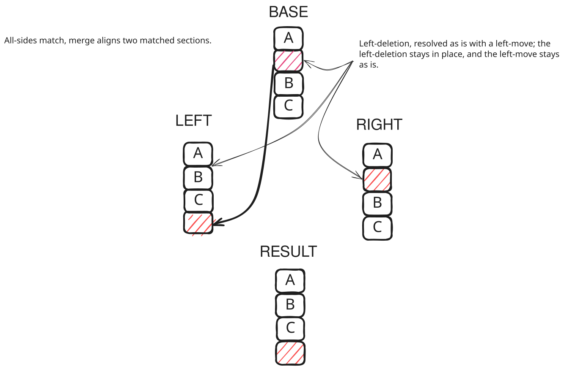
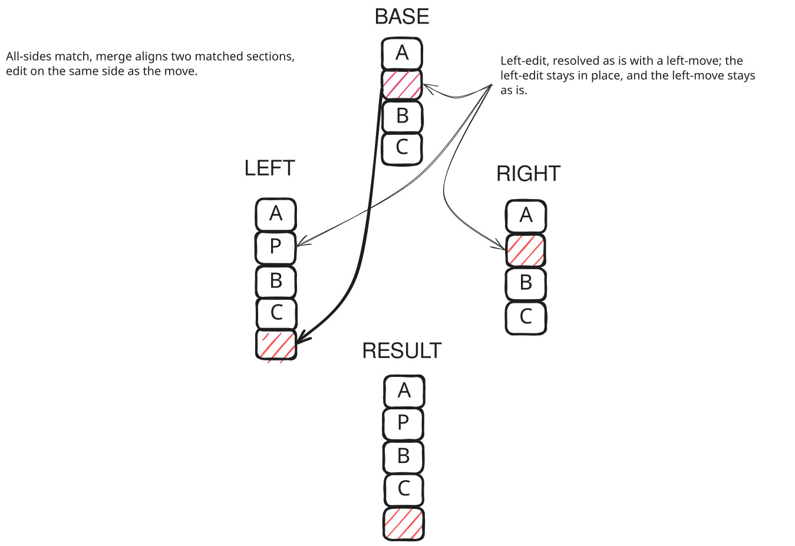
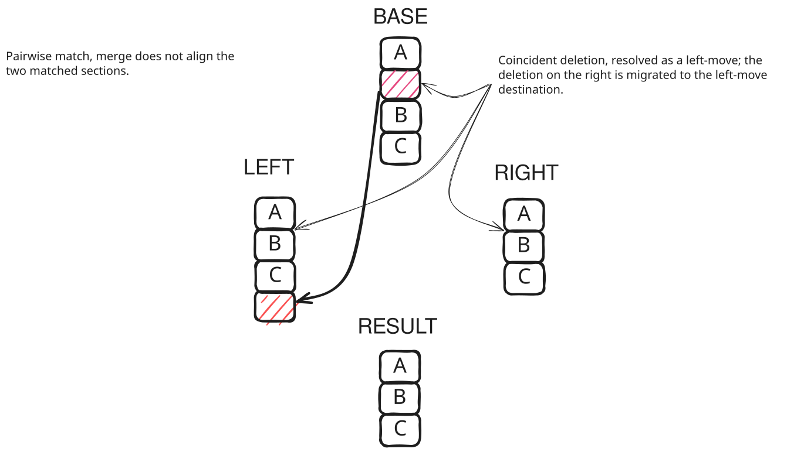
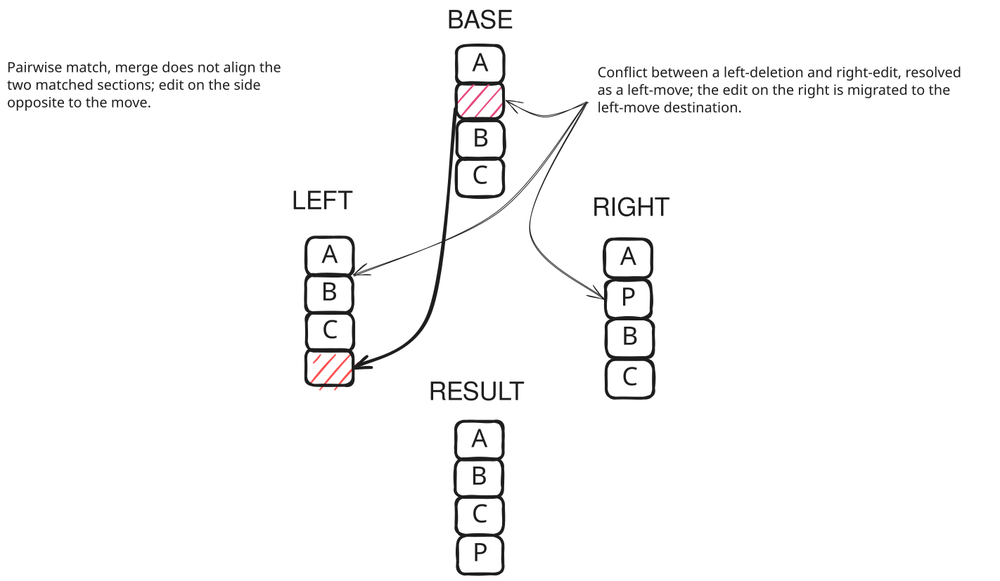
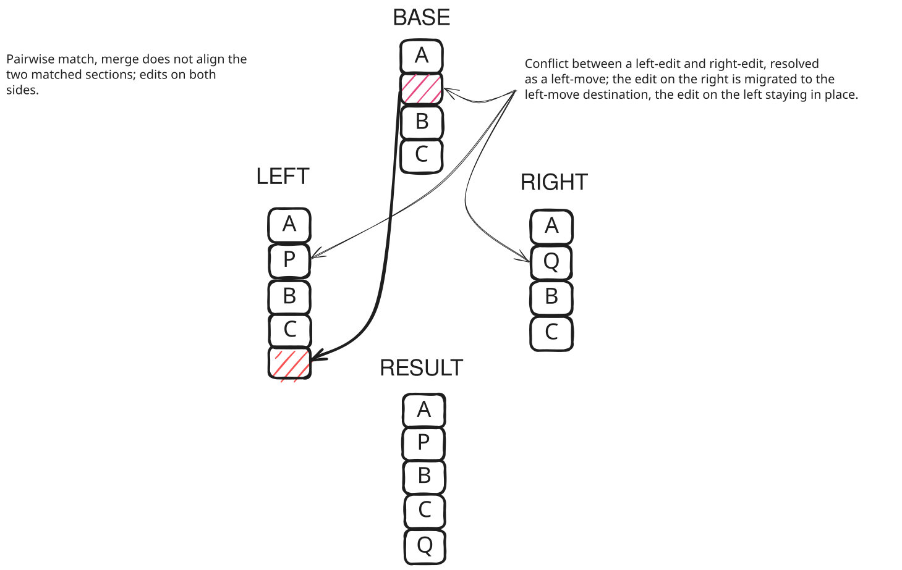
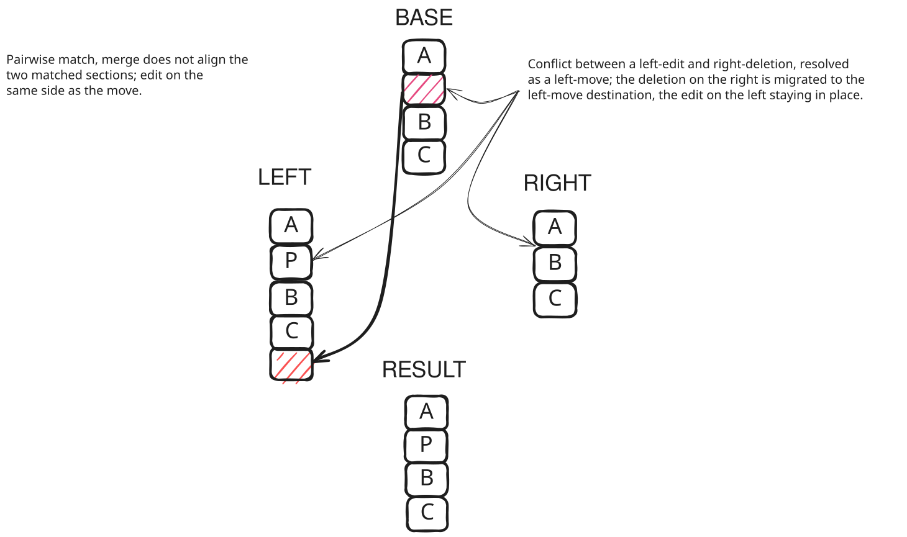
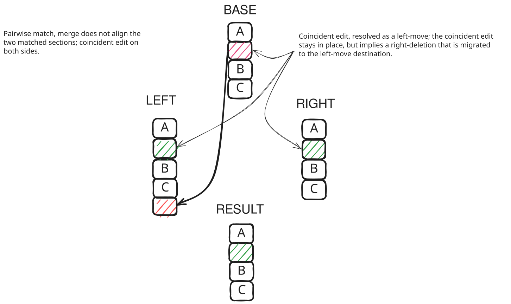
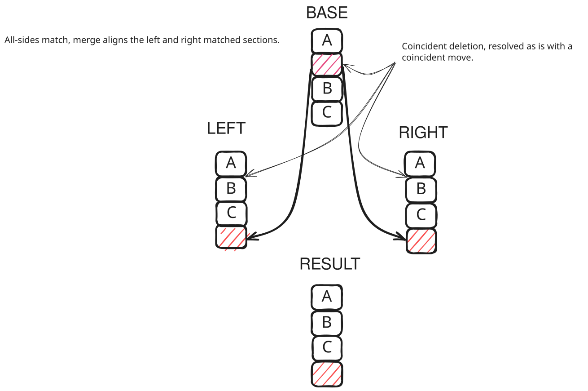
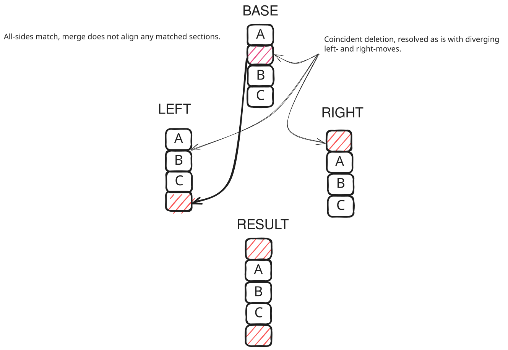

# Code Motion & Migration

## 1. What is Code Motion?

Code motion occurs when a piece of code present in the base commit moves to a new location in either the left branch,
the right branch, or both:

1. **Intra-file code motion**: the code jumps to a different location within the same file; it cannot form part of
   the LCS for that file's three-way merge.
2. **Inter-file code motion**: the code moves from one file to another file with a different path, including file
   renames, splits, joins, extractions and consolidations.

In both cases, the move has:

- A *source*: the original location in the base version.
- A *destination*: the new location on the left or right side.

---

## 2. Coincident and Divergent Moves

When code from a single base source moves on *both* the left and right sides:

- **Coincident Move**: the code moves to the same place on both sides (in the same file, aligned by the three-way
  merge). This is typically due to prior cherry-picking of changes as a preview from our branch to their branch, or less
  formal sharing of patches via email (or indeed just plain eyeballing changes and manually duplicating them). Kinetic
  Merge treats this as a shared refactoring; no conflicts are generated; any subtle whitespace variations are merged.
- **Divergent Move**: the code moves to different files or to non-aligned locations within the same file. Kinetic Merge
  honours both destinations equally, allowing the content to appear in both locations (unless one side deleted the
  containing file). Variations in whitespace are left as is on either side.

---

## 3. Migration

Both coincident and divergent moves have the same piece of code disappear from the source and reappear at a destination
on both the left and the right - so there is nothing further to do about that; both sides agree that the moved piece of
code still exists.

The situation can differ for a move on only one side: when a such move is identified, any modifications made to the
moved code on the opposite branch must follow the move to its destination. This process is termed *migration*.

Migration divides into two distinct mechanisms:

- **Change Migration**: migrating edits or outright deletions of the moved content.
- **Splice Migration**: migrating content inserted adjacent to the moved code.

---

## 4. Change Migration

Change migration applies when a section of code in the base moves to a destination on one side (say, the left), while
the opposite side (the right) either edits or deletes that content at its original location.

### Mechanism

1. **Speculative Detection**: in the first merge pass for each file, `FirstPassMergeResult` records speculative move
   destinations and speculative substitutions (edits or deletions) for each base section.
2. **Global Evaluation**: `MoveDestinationsReport.evaluateSpeculativeSourcesAndDestinations` inspects all speculative
   moves and substitutions globally, putting the actual moves together in `moveDestinationsBySource` and building a
   `MoveEvaluation` from them.
3. **Suppression at Origin**: during the second merge pass for each file, `ConflictResolvingMergeAlgebra` suppresses the
   migrated edit or deletion at its original source location so it does not remain marooned in the old file; this
   resolves fake conflicts.
4. **Substitution Application**: within `SectionedCodeExtension.merge`, `applySubstitutions` replaces
   `moveDestinationAnchor` at the destination with the migrated replacement sections.

### Move Diagrams

#### Simple Move with a Deletion on the Move Side:



#### Simple Move with an Edit on the Move Side:



#### Migrating a Deletion:



#### Migrating an Edit:



#### Migrating an Edit with an Edit on the Move Side:



#### Migrating a Deletion with an Edit on the Move Side:



#### Migrating a Deletion with a Coincident Edit:



#### Coincident Move:



#### Divergent Moves:



---

## 5. Splice Migration

This is motivated by having to migrate new content **inserted adjacent to moved code**; the insertion takes place on the
opposite side to the move.

In contrast with change migration, the destination section should *not* be substituted; rather the inserted content
should migrate to land adjacent to the destination section, either preceding or succeeding it depending on how it was
originally inserted.

Again, the inserted code has to be suppressed at its original location, because it has migrated.

In practice, it is not enough to simply transplant the inserted sections, because there may be content adjacent to the
destination section that is sitting in exactly the place that the migrated insertion needs to go.

There is also the wrinkle that if we have a move, not only can content be *inserted* adjacent to source of the move, but
there may be *deletions or edits to existing content* that is also adjacent. So it is potentially a mixture of
insertions, deletions and edits that require such migration.

### The Anchors of a Move ###

An `AnchoredMove` represents a move on one side only that acts a boundary for splice migration:

- **Mode destination side**: the side where the move took place - either `MoveDestination.Left` or
  `MoveDestination.Right`.
- **Source Anchor**: the base section.
- **Move Destination Anchor**: the section on the move destination side.
- **Opposite Side Anchor**: the corresponding section on the opposite side that didn't move (or a composite edit
  sequence if the move involves an edit migration).

Anchored moves fit into a hierarchy of moves:

- $AllMoves = OneSidedMoves \sqcup TwoSidedMoves$
- $OneSidedMoves = AnchoredMoves \sqcup MigratedDeletions$
- $AnchoredMoves = PlainMoves \sqcup MigratedEdits$
- $TwoSidedMoves = CoincidentMoves \sqcup DivergentMoves$

Note how change migration uses an alternative breakdown:

- $OneSidedMoves = PlainMoves \sqcup MigratedChanges$
- $MigratedChanges = MigratedDeletions \sqcup MigratedEdits$

Migrated deletions are not anchored moves, because anchoring requires boundaries for splices on all three side - there
is no section present on the opposite side to the merge!

---

### Grouping Anchored Moves by Parallel Matches Groups

Rather than evaluating splices independently for every moved section, Kinetic Merge groups anchored moves using their
`ParallelMatchesGroupId` (`anchoredMovesByParallelMatchesGroupId`):

- Successive anchored moves that belong to the same parallel matches group are ordered by their base start offsets:
  `M_1, M_2, ..., M_k`.
- **Intermediate Splices**: For adjacent moves `M_i` and `M_{i+1}` in the group, the intermediate sections sitting
  between them are extracted directly on the base, move destination, and opposite sides:
  ```scala
  // Not exactly the actual code, but gives the idea.
  val intermediateBase = intermediateSectionsBetween(baseFile, M_i.sourceAnchor, M_{i+1}.sourceAnchor)
  val intermediateDestination = intermediateSectionsBetween(destFile, M_i.destinationAnchor, M_{i+1}.destinationAnchor)
  val intermediateOpposite  = intermediateSectionsBetween(oppFile, M_i.oppositeAnchor, M_{i+1}.oppositeAnchor)
  ```
  A three-way merge is executed on these intermediate sections (`spliceMerge`), and the resulting splice is associated
  with
  the succeeding anchor `M_{i+1}`.
- **Boundary Splices**: For the first move `M_1` and last move `M_k` of the group, outward directional scanning finds
  preceding and succeeding content up to the nearest stationary preservations, boundary anchors from other groups or
  beginning/end of file. three-way splice merges are performed for these outer boundaries.

### Splice Merge Flattening

A splice merge replaces the content that was adjacent to the move destination anchor, but there is a wrinkle - the
splice merge may be conflicted. Now if that adjacent content made its way cleanly into file's overall three-way merge,
then it is straightforward to replace it with a conflicted splice merge; the outcome is just a localised conflict, this
is nothing special.

Likewise, if the adjacent content itself ends up inside a conflict and the splice merge is resolved, then we just
replace something inside a conflict with the cleanly resolved result. It's still just a conflict, so no problems there.

Where it gets tricky is when a splice merge conflict ends up inside a conflict - good luck with showing this using
standard conflict markers!

The solution is to flatten such nested merges - it is done in a rather rough-and-ready, arbitrary fashion, but allows
ordinary tools to read the results.
