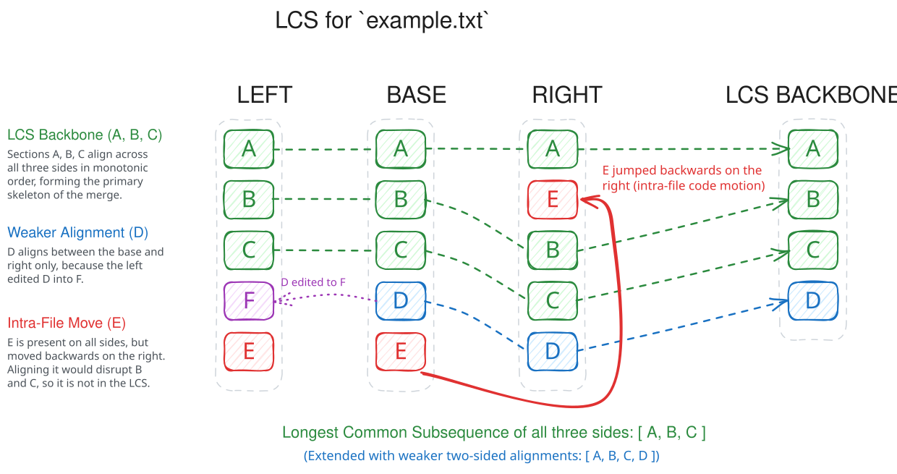

# Modelling of the Problem Space #

## Sources, Sides, Sections, and Tokens ##

Kinetic Merge abstracts merging away from version control systems - it uses a *sources* instance to represent the
version of the codebase as seen from a commit or directory tree. A sources instance breaks down into *files*, each of
which is associated with a *path*.

There are three *sides* to a merge:

1. `base`: the common ancestor version.
2. `left`: the version from our branch or directory tree.
3. `right`: the version from their branch or directory tree.

Each side contributes its own sources.

In the core library, path types and content element types are generalised (`Path`, `Element`), allowing thorough unit
testing with simple types for paths and elements, while the CLI applications work with filesystem paths and `Token`
instances.

### Tokens and Whitespace Insensitivity

Source files are tokenized upfront into sequences of `Token`s. Tokens demarcate identifiers, numbers, keywords, operator
symbols, punctuation, or string literals. Whitespace is folded into adjacent tokens: in general, whitespace is attached
as a suffix of the preceding token, but leading indentation on a line is attached as a prefix to make reading through
tokens more natural.

When comparing tokens for equality (e.g. during hashing or dynamic programming), the attached whitespace is ignored,
delivering **whitespace insensitivity**. Only standalone leading whitespace at the very start of a file is compared
explicitly against other whitespace tokens. String literals are treated as atomic tokens (preserving internal formatting
and whitespace).

### Sections and Files

A file in a source is covered by an indexed sequence of non-overlapping, contiguous *sections* (`Section[Element]`).
Each section covers a continuous piece of content in a file that is demarcated by a start offset and one past the end
offset - so a closed-open interval of offsets into the file content. A section does not have to align with line
boundaries - it may refer to just a part of a single line, or span several lines with the start and / or end being
ragged, i.e. not spanning an entire line.

Crucially:

- A `Sources` instance is a factory for sections and maps sections back to their file paths.
- Sections are compared by their defining attributes (`path`, `startOffset`, `size`), *not* by object identity or
  content equality. Two sections with identical text on different sides are distinct objects.
- A `File[Element]` is a synthetic container whose total content is formed by the concatenation of its contiguous
  constituent sections.

## Matches and Merging ##

Match analysis (`MatchAnalysis`) discovers matches of equivalent swathes of content across sides:

- **All-Sides Match (`Match.AllSides`)**: a three-way match comprising a section in `base`, a section in `left`, and a
  section in `right`.
- **Pairwise Match (`Match.BaseAndLeft`, `Match.BaseAndRight`, or `Match.LeftAndRight`)**: a two-way match comprising
  sections on two sides.

Note the subtlety - a match consists of sections covering equivalent content (i.e. the same elements), but the sections
in a match cannot be equal because they come from different sides.

The matches are optimised so that:

- The matched content in each match is as long as possible.
- As many matches as is practical are found. Once discovered, matches are reconciled to resolve overlaps and eliminate
  redundancies.

### Three-Way Merging and Longest Common Subsequence ###

Merging takes place both at a global level, looking at all the paths and taking code motion into account, and also at a
file-by-file level, performing an augmented three-way merge on each file path. What is merged is not the raw content
of the sources' files, rather it is the sections that are rearranged by the merge at both global and file-by-file level.
While a section belongs to a sources instance for one of the three sides, it can be queried for the content it covers -
so rearranging sections is tantamount to rearranging the underlying content.

The file-by-file three-way merge itself depends on a more fundamental notion, that of finding the *longest common
subsequence* (LCS). The longest common subsequence, in concert with matching, contributes in two ways to the big picture
of
merging:

1. it provides a skeleton to hang the three-way merge around for each file path and
2. it identifies code motion.

Bear in mind that in a merge, both the left and right side will see changes to the content of a file, so even if a piece
of code doesn't move to a completely different location from the point of view of how the code is logically
structured, it may still move from one offset to another if we compare content for the same file across different sides.
So to detect genuine code motion, we need a more flexible notion of movement - and this is what the combination of the
longest common subsequence and matching gives us.

The longest common subsequence for a file path is made from the sections taken from all three sides, aligning
corresponding sections across the sides, throwing away sections that don't correspond across the sides and respecting
the original order of the sections that are aligned.

Let's see an example, where sections with matching content across the three sides are given the same letter:

Given a base file for `example.txt` that breaks down into sections *A*, *B*, *C*, *D*, *E*,
a left file for `example.txt` that breaks down into sections *A*, *B*, *C*, **F**, *E* and
a right file for `example.txt` that breaks down into sections *A*, **E**, *B*, *C*, *D*,
this then yields the longest common subsequence of *A*, *B*, *C*.

*D* is not present on the left - it has been edited into *F*, and *E* has moved backwards on the right to come in
between *A* and *B*.

In fact, we can extend this by considering *D* to be part of the longest common subsequence, but in a weaker role - it
only aligns on the base and right side.

What drives the correspondence of three sections from across the sides is whether they all belong to the same match (or
just two of them for the weaker situation). The resulting longest common subsequence then forms the backbone of the
three-way merge, the shared content for a full alignment across all three sides making it through directly into the
output of the three-way merge. Weaker alignments across just two sides could denote either an edit or a deletion (if
between the base and either the left or the right), or a coincident edit or insertion (if between the left and right).
Where there is no alignment at all indicates a conflict.

What happens if the sections are matched across three or two sides, but can't be brought into alignment by the longest
common subsequence algorithm? This is the case for section *E* - it is present on all three sides, but attempting to
align it would throw *B* and *C* out of kilter, thus resulting in a suboptimal common subsequence.

In this situation, we take this as evidence of intra-file code motion - because *E* can't join the backbone of the
merge, it is considered to have 'jumped around' on the right.

### Identifying Code Motion and Performing Migrations ###

The combination of global match analysis and per-file LCS alignment cleanly separates stationary code from moved code:

- **Stationary Preservations**: Sections that appear in the base and align with their corresponding sections in the
  same file's LCS on both left and right are stationary.
- **Code Motion (Moves)**: When a section in the base has matched content on the left or right, but does *not* align in
  the per-file LCS (or appears at a completely different file path), it has **moved**.
    - **Intra-file move**: Moved to a different offset within the same file.
    - **Inter-file move**: Moved to a file at a different path.
- **Change Migration**: If code moves from the base to a destination on one side, and the opposite side edits or deletes
  that code at its original location, Kinetic Merge migrates the edit or deletion to the move destination.
- **Splice Migration**: If new content is inserted or edited adjacent to the source of a move, Kinetic Merge performs a
  three-way splice merge and migrates the resulting splice adjacent to the moved section at its destination.
- **Recursive Unpicking**: Migrated edits and splices are nested into the merge result and resolved via bottom-up
  recursive flattening, preserving local conflict boundaries.

### Parallel Matches Groups ###

Individual matches are not isolated; they frequently occur in sequences where successive matches move together in
parallel (for example, several functions moved together from one file to another, interspersed with minor local edits).

Kinetic Merge unifies such correlated matches into *parallel matches groups*, identified by a unique
`ParallelMatchesGroupId`.

1. Parallel sequences of all-sides matches are unified across all three sides.
2. Parallel sequences of pairwise matches are unified across their participating sides.
3. Bridges between all-sides groups and pairwise groups are established when they align continuously, including
   "sandwich" structures where a pairwise match accompanies an edit or deletion lying between two all-sides matches.
4. Matches within each parallel matches group must strictly march upward in start offsets on all shared sides without
   collisions.

The matches discovered by match analysis are thinned out into parallel matches groups to prevent a combinatoric
explosion of matches, while
capturing the essence of code motion.

### Blocks ###

In large codebases, running a full LCS algorithm over individual sections across all three versions of a file is
computationally not feasible except for quite small files.

To make alignment fast and scalable, Kinetic Merge groups sections into higher-level *blocks* (`SectionedCode.Block`):

- A block covers a contiguous sequence of sections in a file spanned by a parallel matches group on a given side; gaps
  between the matches are included.
- Intervening gaps between group-originated blocks are covered by *filler blocks*.
- Blocks covering the same file content due to colliding parallel matches groups are coalesced together.
- All nested blocks are suppressed, while overlapping blocks spanning different ranges are permitted.
